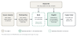

# goodcopy

A toolkit for turning the files you work in into finished, branded
deliverables: pages a reader can open anywhere as one file, and, as the
toolkit grows, the spreadsheets and Word copies that sit beside them. The aim:
you write content once, in plain working files; the toolkit builds every
deliverable from them, applies your brand as data, and writes them to a
folder nobody edits by hand. Today it holds the page-making stage of that
flow, and a short build script of your own does the rest (see
[What is here today](#what-is-here-today)).

goodcopy is several pieces in one repository. The first is
[**PageKit**](pagekit/README.md), its own installable package: one
self-contained, brandable HTML page per document, with reader features built
in. More pieces join as they are written.

Licensed under the Apache License 2.0.

## How it is meant to be used



| Stage | What happens | Who provides it |
|---|---|---|
| **1. Source material** | Whatever you gathered: notes, exports, papers, survey results, other people's documents. Kept as received, so you can always go back to it. | You |
| **2. Working files** | What you write from that material, and the only thing you edit. Any of: **prose** (the words of a page, in plain text or HTML), **settings** in YAML (what each deliverable is, who it is for, which parts it has), **data tables** (CSV), a **register** (one row per item, such as a list of requirements or risks, that becomes a spreadsheet and the cards on a page), **hand-written HTML** for a page with a layout of its own, or a **build script** for a page that is computed. | You |
| **3. Build** | Turns each working file into its deliverable: prose into a page, a register into a workbook and the cards on a page, a page into a Word copy where one is needed. | goodcopy, in time. Today you write a short build script that calls PageKit (below). |
| **Brand file** | Your organisation's name (and a second-language name if you use one), logo, palette and font. Data, not stylesheets: change the file and every deliverable changes with it. | You write it; goodcopy applies it |
| **4. PageKit** | Makes each page one HTML file that carries its own styles and script: a contents panel with search, parts shown one at a time, long tables that open at their first rows, identifiers and defined terms that explain themselves, copying a table or diagram out, light and dark, print. A security marking or a watermark (DRAFT, say) is set per document as the page is built. It works opened from disk, from a mail attachment, or inside a document viewer's locked-down frame. | goodcopy (`pagekit/`) |
| **5. Output folder** | What your readers get. Rebuilt from the working files every time, so a change is made once in a working file and never by hand in an output. | Written by the build |

## A worked example

*Example Trust* (invented, like everything in this repository) runs a
community garden and writes a season report for its members each autumn.

```
example-trust/
  sources/                 the plot survey, the volunteer roster export, the committee's notes
  working/
    brand.json             the Trust's name, logo and colours
    season-report/
      summary.html         one file per part of the report, in plain HTML
      harvest.html
      next-season.html
  build.py                 the build script (goodcopy's build stage, until it moves in)
  out/                     written by build.py; never edited by hand
```

`working/brand.json`:

```json
{"name": "Example Trust", "name_te_reo": "Te Rōpū Tauira",
 "palette": {"primary": "#2a7f62", "secondary": "#1f3a5f", "accent": "#c2862b"}}
```

`build.py`:

```python
import json
from pathlib import Path

import pagekit

HERE = Path(__file__).parent
brand = json.loads((HERE / "working/brand.json").read_text(encoding="utf-8"))
report = HERE / "working/season-report"
parts = [{"id": stem, "title": title, "html": (report / f"{stem}.html").read_text(encoding="utf-8")}
         for stem, title in [("summary", "The season in brief"),
                             ("harvest", "What the plots grew"),
                             ("next-season", "Next season")]]

page = pagekit.page("Season report", brand=brand, parts=parts,
                    lead="How the garden did this season, and what we plan next.",
                    watermark="DRAFT")
problems = pagekit.check(page)    # anything that would stop the page travelling as one file
assert not problems, problems
(HERE / "out").mkdir(exist_ok=True)
(HERE / "out/season-report.html").write_text(page, encoding="utf-8")
```

`python3 build.py` writes `out/season-report.html`: one file, three parts
chosen from the panel, the Trust's colours in light and dark, DRAFT across
every page. When the treasurer corrects a figure, the fix goes in
`working/season-report/harvest.html` and the page is built again. When the
report is final, the watermark comes out of `build.py`, not out of the page.

[`pagekit/examples/sample.html`](pagekit/examples/sample.html) is the same
Trust's season report built with every feature PageKit has; its build script
is [`pagekit/examples/sample.py`](pagekit/examples/sample.py).

## What is here today

| Piece | What it does | Here? |
|---|---|---|
| `pagekit/` | One self-contained, branded page per document (stage 4) | ✅ Yes, its own package |
| The build stage | Prose, settings and registers into pages, workbooks and Word copies (stage 3) | ⏳ Not yet; a build script of your own does its job until then |
| Checks across a set of deliverables | That every deliverable is built, current and consistent before it is sent | ⏳ Not yet |

This guide is brought up to date as each piece arrives.

## Install

PageKit on its own, standard-library Python 3.11 or later:

```bash
pip install "pagekit @ git+https://github.com/mike548141/goodcopy#subdirectory=pagekit"
python3 -m pagekit check PAGE.html
```

[`pagekit/README.md`](pagekit/README.md) is PageKit's reference: every
feature, the brand format, where pages have to work and the traps paid for
when changing it.

## Working on goodcopy

`make venv` and `make hooks` once per clone, then `make check` before every
commit (the publication guard, then lint, types and tests for each package).
[`CONTRIBUTING.md`](CONTRIBUTING.md) has the rules; the first of them is that
nothing in this repository names or describes a real organisation.
